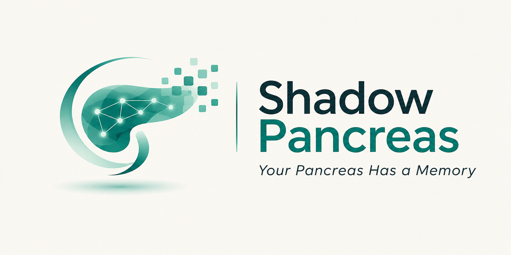

<p align="center"></p>

# Shadow Pancreas

**English** · [Türkçe](#türkçe)

*Type 1 diabetes: match today's menu to your own past meals, with the insulin units taken and the 2-hour post-meal glucose for each.*

> ## ⚠️ Data notice
> The dataset in this repository (`data/synthetic/`) is **100% synthetic**: 30 days of randomly generated meals, glucose and insulin values. It contains no real person's data and exists only so the code can be run and inspected.
>
> **All metrics, evaluations and findings in `reports/` were measured on the author's real, private dataset (Jan–Oct 2026), which is not published.** Numbers you get from the synthetic demo data will not match the reported ones.
>
> Without real data the app automatically loads `data/synthetic/` and shows a "demo mode" banner. Regenerate it with `python tools/make_synthetic.py`. Point to another data folder with `DIYALIFE_DATA`.

> **This project is a prototype and is not medical advice.** The app never recommends an insulin dose. It only shows the user's own past records.

## What it does

Built for a person with Type 1 diabetes who eats from a known, repeating menu. Right before a meal, the user enters today's menu and the pre-meal glucose. The app retrieves the most similar past meals from the user's own log and shows, for each one, the insulin units injected and the 2-hour post-meal glucose. A local LLM narrates these cases briefly. The UI is available in English (default) and Turkish.

### Screens

- **Today:** the date defaults to today; the menu loads from the menu file if available, otherwise the user enters it (autocomplete; unknown names are mapped to the 5 closest dishes). After entering the pre-meal glucose, similar past meals and the LLM summary appear. After the meal, the injected dose and the 2-hour glucose can be saved and the meal joins the history.
- **History:** every logged day, month by month. For each meal: pre-meal glucose → units → 2-hour glucose, plus the menu. Meal filter and dish-name search.
- **Model & About:** measurement results and method.

### How similar meals are found

1. Today's main dishes are extracted: soup, main dish, rice/pasta, dessert, pastry. Items that appear every day (salad, yogurt, breakfast plate) are ignored.
2. Past meals are ranked in this order:
   - number of exactly matching dishes (main-dish matches count before soup),
   - dishes from the same family (e.g. kuru fasulye with/without meat; TR-MTEB "name + ingredients" embedding cosine ≥ 0.85),
   - closeness of pre-meal glucose, **last**.
3. No averages are computed. The summary shows only the units and 2-hour range of cases whose pre-meal glucose is within ±30 mg/dL of today's value.
4. Pool: all meals with a menu and a measurement, weekends included, official holidays excluded, plus whatever the user records in the app.

Menu item → standard dish matching: TF-IDF character n-grams + `BAAI/bge-m3`, fused with RRF. Dish → nutrition: recipe parsing with USDA FoodData Central SR Legacy (CC0).

The LLM runs locally (Gemma 4 E4B via llama.cpp `llama-server`). Its output goes through checks and is replaced by a template summary if it fails:
- every number and date in the summary must appear verbatim in the context,
- dose-advice patterns are forbidden,
- "average" and "total" are forbidden.

### Results (measured on the private real dataset)

- Retrieval, top-5: on average 62% of today's main dishes are found exactly; the earlier glucose-window prototype and random selection both reach 17%.
- LLM summaries (60, TR + EN): 99% of dated claims belong to the right case, 0% forbidden language, 93% pass the automatic check (the rest fall back to the template).
- Menu-name matching (194 real menu spellings): 83% top-1, 99% top-5.

Post-meal glucose is mostly driven by pre-meal glucose and the dose, so the app retrieves similar cases; it does not predict outcomes. Details are in `reports/`.

## Run

```powershell
powershell -ExecutionPolicy Bypass -File start.ps1
```

This starts llama-server (`E:\model\gemma4-e4b.gguf`, port 8081) and the app (port 8000); adjust the paths in `start.ps1` for your machine. To run only the app (LLM falls back to template summaries): `python app/server.py`.

The app is reachable on the network by default; devices on the same network can open `http://<your-ip>:8000`. Set `DIYALIFE_HOST=127.0.0.1` for local-only access. There is no login, so be careful on shared networks.

Re-running the data and measurement pipeline requires the real raw data (`data/raw/`, not in this repository): `python tools/pipeline.py`. Final accuracy tests: `python tools/eval_final.py` (needs the LLM server).

Requirements: pandas, numpy, scikit-learn, lightgbm, sentence-transformers, fastapi, uvicorn, httpx, openpyxl.

## Layout

| Path | Contents |
|---|---|
| `data/synthetic/` | **synthetic** 30-day demo data (the only meal/glucose data in the repo) |
| `data/raw/` | real raw inputs (glucose log, menu file), **not in the repo**, author's machine only |
| `data/nutrition/` | ingredient dictionary + USDA mapping, standard dishes, recipes, menu spelling → dish mappings |
| `data/user/` | menus and records entered in the app (git-ignored) |
| `src/prepare.py` | Excel → meal events |
| `src/diyalife/` | nutrition vectors, name matcher, engine, LLM summarizer, models |
| `src/evaluate.py` | leave-one-month-out CV of post-meal glucose models (research only) |
| `tools/` | pipeline, LLM comparison, validation, final evaluation, synthetic data generator |
| `reports/` | aggregate measurement results (JSON/HTML) |
| `app/` | FastAPI server and UI |

## Sources and tools

- Data behind the measurements: the user's own glucose and insulin log (2026) and cafeteria menus. **Not published**; only synthetic demo data is in the repo.
- USDA FoodData Central, SR Legacy (2018-04, CC0). Glycemic index values from international GI tables (Atkinson et al.), approximate.
- Models: `BAAI/bge-m3`, `trmteb/turkish-embedding-model`, Gemma 4 E4B (GGUF, llama.cpp). Gemma 4 E2B / 26B-A4B and Qwen3.5-9B were also compared.
- Libraries: scikit-learn, LightGBM, sentence-transformers, FastAPI.
- An AI coding assistant was used to write the code.

---

<a id="türkçe"></a>

# Türkçe

[English](#shadow-pancreas) · **Türkçe**

*Tip 1 diyabet için: bugünün menüsünü kendi geçmiş öğünlerinle eşleştir; her birinde vurulan insülin ünitesi ve 2. saat tokluk şekeri.*

> ## ⚠️ Veri notu
> Bu repodaki veri seti (`data/synthetic/`) **%100 sentetiktir**: 30 günlük, rastgele üretilmiş öğün, şeker ve insülin değerleri. Gerçek bir kişinin verisi değildir; yalnızca kodun çalıştırılıp incelenebilmesi için vardır.
>
> **`reports/` altındaki tüm ölçümler, değerlendirmeler ve bulgular yazarın gerçek, özel veri seti (Ocak–Ekim 2026) üzerinde yapılmıştır ve bu veri yayımlanmamıştır.** Sentetik demo veriyle elde edeceğin sayılar raporlananlarla örtüşmez.
>
> Gerçek veri yoksa uygulama otomatik olarak `data/synthetic/` klasörünü yükler ve "demo modu" bandı gösterir. Yeniden üretmek için `python tools/make_synthetic.py`. Başka bir veri klasörü için `DIYALIFE_DATA` ayarlanır.

> **Bu proje bir prototiptir ve tıbbi tavsiye değildir.** Uygulama hiçbir zaman doz önermez. Yalnızca kullanıcının kendi geçmiş kayıtlarını gösterir.

## Ne yapar

Tip 1 diyabetli, her gün bilinen bir menüden yemek yiyen biri için. Kullanıcı yemekten hemen önce bugünün menüsünü ve açlık şekerini girer. Uygulama kendi kayıtlarından menüsü en çok benzeyen geçmiş öğünleri getirir. Her birinde o gün kaç ünite insülin vurulduğunu ve 2. saat tokluğun kaç çıktığını gösterir. Yerel bir LLM bu vakaları kısaca anlatır. İngilizce (varsayılan) ve Türkçe çalışır.

### Ekranlar

- **Bugün:** Tarih bugünün tarihiyle gelir. Menü menü dosyasında varsa otomatik gelir, yoksa kullanıcı girer (yazarken öneri çıkar, bilinmeyen adlar en yakın 5 yemeğe eşlenir). Kullanıcı açlığını girer ve benzer geçmiş öğünleri ile LLM özetini görür. Yemekten sonra vurduğu doz ve tokluk kaydedilebilir, öğün geçmişe eklenir.
- **Geçmiş:** Tüm kayıtlı günler ay ay listelenir. Her öğün için açlık → ünite → tokluk ve menü görünür. Öğün filtresi ve yemek adıyla arama vardır.
- **Model ve Hakkında:** ölçüm sonuçları ve yöntem.

### Benzer öğün nasıl bulunur

1. Bugünün ana yemekleri çıkarılır: çorba, ana yemek, pilav/makarna, tatlı, hamur işi. Her gün aynı olan salata, yoğurt ve kahvaltı tabağı sayılmaz.
2. Geçmiş öğünler şu sırayla dizilir:
   - birebir aynı yemek sayısı (ana yemek eşleşmesi çorbadan önce gelir),
   - aynı aileden yemekler (ör. etli/etsiz/gemici usulü kuru fasulye; TR-MTEB "ad + malzeme" embedding'i ≥ 0,85),
   - açlık yakınlığı, **en son**.
3. Ortalama alınmaz. Özet satırında yalnızca açlığı bugüne ±30 mg/dL içinde olan vakaların ünite ve tokluk aralığı gösterilir.
4. Havuz: menüsü ve ölçümü olan tüm öğünler. Hafta sonları dahil, resmi tatiller hariç, kullanıcının uygulamada kaydettikleri dahil.

Menü kalemi → standart yemek eşleştirmesi: TF-IDF harf n-gram + `BAAI/bge-m3`, RRF ile birleştirilir. Yemek → besin değeri: tarif ayrıştırması ve USDA FoodData Central SR Legacy (CC0).

LLM yerel olarak çalışır: Gemma 4 E4B, llama.cpp `llama-server`. Çıktısı şu kontrollerden geçer, geçemezse şablon özet gösterilir:
- özetteki her sayı ve her tarih bağlamda birebir bulunmalı,
- doz önerisi kalıpları yasak,
- "ortalama" ve "toplam" yasak.

### Sonuçlar (özel gerçek veri üzerinde ölçüldü)

- Geri getirme, ilk 5: bugünün ana yemeklerinin ortalama %62'si birebir bulunuyor; açlık penceresine dayalı eski prototip ve rastgele seçim %17'de kalıyor.
- LLM özetleri (60 özet, TR + EN): tarihli iddiaların %99'u doğru vakaya ait, yasak dil %0, otomatik kontrolden geçme %93 (geçemeyenlerin yerine şablon gösterilir).
- Menü adı eşleştirme (194 gerçek menü yazımı): ilk tahminde %83, ilk 5'te %99.

Tokluk şekerini asıl belirleyen açlık ve vurulan dozdur. Bu yüzden uygulama benzer vakaları getirir, sonucu tahmin etmez. Ayrıntılar `reports/` içinde.

## Çalıştırma

```powershell
powershell -ExecutionPolicy Bypass -File start.ps1
```

Bu komut llama-server'ı (`E:\model\gemma4-e4b.gguf`, port 8081) ve uygulamayı (port 8000) başlatır; yolları kendi bilgisayarına göre `start.ps1` içinde değiştir. Yalnızca uygulamayı çalıştırmak için (LLM yoksa şablon özet gösterilir): `python app/server.py`.

Uygulama ağda açıktır: aynı ağdaki cihazlar `http://<bilgisayarın IP'si>:8000` adresinden girer. Yalnızca bu bilgisayardan erişmek için `DIYALIFE_HOST=127.0.0.1` ayarla. Uygulamada giriş/şifre yok, ortak ağlarda dikkatli kullan.

Veri ve ölçüm hattını baştan çalıştırmak için gerçek ham veri gerekir (`data/raw/`, repoda yok): `python tools/pipeline.py`. Son doğruluk testleri için: `python tools/eval_final.py` (LLM sunucusu açık olmalı).

Gereken paketler: pandas, numpy, scikit-learn, lightgbm, sentence-transformers, fastapi, uvicorn, httpx, openpyxl.

## Klasörler

| Yol | İçerik |
|---|---|
| `data/synthetic/` | **sentetik** 30 günlük demo veri (repoda olan tek öğün/şeker verisi) |
| `data/raw/` | gerçek ham girdiler (şeker kaydı, menü dosyası), **repoda yok**, yalnızca yazarın yerelinde |
| `data/nutrition/` | malzeme sözlüğü + USDA eşleşmesi, standart yemekler, tarifler, menü yazımı → yemek eşleşmeleri |
| `data/user/` | uygulamada girilen menüler ve kayıtlar (git dışında) |
| `src/prepare.py` | Excel → öğün olayları |
| `src/diyalife/` | besin vektörü, ad eşleştirici, motor, LLM özetleyici, modeller |
| `src/evaluate.py` | tokluk tahmin modellerinin ay-dışarıda çapraz doğrulaması (araştırma) |
| `tools/` | hat, LLM karşılaştırması, doğrulama, son değerlendirme ve sentetik veri üreticisi |
| `reports/` | toplu ölçüm sonuçları (JSON/HTML) |
| `app/` | FastAPI sunucusu ve arayüz |

## Kaynaklar ve araçlar

- Ölçümlerde kullanılan veri: kullanıcının kendi şeker ve insülin kaydı (2026) ve yemekhane menüleri. **Yayımlanmadı**; repoda yalnızca sentetik demo verisi var.
- USDA FoodData Central, SR Legacy (2018-04, CC0). Glisemik indeks değerleri uluslararası GI tablolarından (Atkinson ve ark.), yaklaşık değerler.
- Modeller: `BAAI/bge-m3`, `trmteb/turkish-embedding-model`, Gemma 4 E4B (GGUF, llama.cpp). Karşılaştırmada Gemma 4 E2B / 26B-A4B ve Qwen3.5-9B de denendi.
- Kütüphaneler: scikit-learn, LightGBM, sentence-transformers, FastAPI.
- Kodun yazımında yapay zekâ kodlama asistanı kullanıldı.
